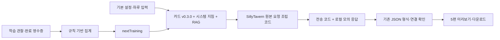

# Foundation 연동 Worker 실행 안내(현재 제품 경로)

이 폴더는 기존 독립 실험실을 재사용한다. 현재 웹/백엔드 연결의 시작점은 **`npm run start:foundation`** (`integration/server.mjs`)이며 아래 과거 실험실의 `npm start`와 다르다. `npm start`는 기존 MOCK 실험 화면이므로 운영 제작 서버의 대체가 아니다.

Node24 이상과 Python3가 필요하며 JS 외부 패키지 설치는 없다. Typecast는 동봉 Python adapter를 자식 프로세스로 실행한다. PostgreSQL 직접 접근은 하지 않고 백엔드의 인증된 `/internal/v2/agent-storage` 포트를 사용한다.

2026-11-06 한국어 말투 묶음은 `prompts/korean-peer-style.json`이다. 사용자가 작성한 만화 대회 대화를 도입/선택 반응의 문체 예시로 전달하며 소재를 그대로 복사하지 않도록 구분한다. 현재 V2.1의 고정 지침은 `src/stateful-authoring.mjs`에서 읽으며, 아래 실험실의 `prompts/system.md`만 바꾸는 것으로는 V2.1이 바뀌지 않는다. 새 제작 설정 참조는 `prototype-st-v2.1-ko4`; 기존 DB 원고/음원/승인을 다시 쓰지 않는다. 생성은 여전히 계획1+턴40이며 자동 의미 검수·부분 수정·퀴즈 LLM 호출을 추가하지 않았다. 무료 요청 조립 검사는 실제 GPT의 자연스러움 성공을 뜻하지 않는다.

`src/dialogue-planning.mjs`는 현재 V2.1의 일별 씨드/관계 정책이다. 예제 문제은행의 고정 감정 순서를 사용하지 않고 날짜별 서로 다른 대화 목적/허용 장소를 선택한다. 후속 대화는 실제 NPC별 기억이 있을 때만, Home은 초대 근거가 있을 때만 허용한다. planner의 사건은 null일 수 있고 미해결 문제는 선택적이며, 같은 감정을 유지하거나 해결하지 않고 닫는 대화도 허용한다. 기존 최종 JSON/웹/Unity 퀴즈15종은 유지한다. NEUTRAL은 대화 중간 상태에 사용할 수 있으나 현재 퀴즈 정답 범위가 아니므로 다른 감정으로 몰래 치환하지 않는다.

서버의 NPC별 관계/evidence와 같은 날 앞편의 **계획된 등장**을 매 턴 `currentEncounter`로 전달한다. UNKNOWN은 첫 만남이 아니며, 첫 만남 근거가 확인된 첫 등장에서만 짧은 소개가 선택적으로 가능하다. 이름을 물어보면 대답할 수 있다. 앞편 계획을 실제 아동 수행/친밀감으로 기록하지 않는다. 원본0.3.0 카드는 보존하고 비첫만남 요청에는 조건부 첫 만남 설명/인사 예시를 덜어 투영한다. 바뀐 정책으로 예전 LIVE 중간 작업을 재개하지 않도록 ko4 외 입력은 모델 호출 전에 차단하며, 이미 완성된 결과 조회/음원은 유지한다.

- MOCK: `EF_AGENT_V2=true`, `EF_AGENT_MODE=MOCK`. backend는 `EF_PROTOTYPE_LIVE_ENABLED=false`로 맞춘다. 무료 PCM은 음성 대사가 아니다.
- LIVE: Worker `EF_AGENT_MODE=LIVE`와 backend `EF_PROTOTYPE_LIVE_ENABLED=true`. 제공자 두 키/목소리는 서버 실행환경에만 공급한다. 준·나래 v0.3.0 카드와 SillyTavern 원본 validator/파생 요청 코드가 실제 제작에 사용된다.
- Worker/API 공통 모델은 `EF_AGENT_MODEL=gpt-5.4`다. backend의 `EF_AGENT_CONFIGURATION_REF`가 source snapshot에 들어간다.
- Worker `EF_AGENT_PORT`, backend `EF_AGENT_URL`, Worker `EF_AGENT_STORAGE_ORIGIN`, 양쪽 동일 `EF_AGENT_SERVICE_TOKEN`을 맞춘다. 토큰은32자 이상이며 공개 웹/Unity에 전달하지 않는다.
- 시작은 DB→Worker 내부 readiness→backend→웹이다. Worker는 loopback에만 listen한다. 다른 호스트에 둘 때는 담당자가 인증된 사설 HTTPS 통신 경로를 제공해야 한다.
- 최신 `../Dockerfile`은 Java21·Node24·Python3와 이 Worker를 포함한다. `../runtime/serve.py`가 비공개 Worker를 먼저 준비하고 API를 실행하며, 한 프로세스가 종료되면 자신이 실행한 짝 프로세스만 종료한다. 실제 이미지 빌드/운영 배포는 아직 실행하지 않았다. 환경·DB 연결은 담당자가 `../docs/DEPLOY_PROTOTYPE.md`에 따라 설정한다.

상세 흐름/환경/신규 계약은 [`../docs/PROTOTYPE_CONNECTIONS.md`](../docs/PROTOTYPE_CONNECTIONS.md)를 따른다. `npm test`와 `npm run check:vendor`는 무료 로컬 코드 검사이며 실제 제공자 품질 검사를 대신하지 않는다.

2026-11-05 현재 실제 LIVE5편과105개 Typecast 음원이 READY다. 사용자는 iPad에서 내용이 나오는 것을 확인했으며 무음 문제를 보고했다. 서버 표본 파형은 정상이고, 수정 앱의 출력·5편 완주·이틀 인수는 별도 확인 항목이다. 기존 독립 실험실의 과거 설명을 아래에 보존한다.

---

# 표현친구 · SillyTavern Agent 실험실

별도 로컬 서비스에서 **기본 설정 → 하루 5편 요청 → 분기 미리보기 → 기존 형식 JSON 다운로드**를 확인한다. 학습 기록은 LLM 없이 집계하고 다음 요청의 `nextTraining`에 반영한다. 기존 제품·Unity·DB·SillyTavern 설치를 수정하지 않는다.

**이 버전은 MOCK ONLY다.** 실제 GPT/Typecast 호출은 실행하지 않았으며 웹 설정이나 환경 변수로 활성화할 수도 없다. 모의 본문은 `examples/generate-response.json`의 고정 창작 예시다. 설정의 관심사·지침을 바꿔도 모의 사건 자체가 새로 쓰이지 않는다. 실제 GPT용 입력과 ST 요청 조립·전송 경로는 준비되어 있다. 이후 유료 실행을 승인받으면 별도 변경에서 `generate()`의 실제 transport를 서버에 연결한다. 이때도 하루 요청은 한 번, 자동 재시도·검수·부분 수정은 없다.

## 실행

Node.js 24 이상. 추가 패키지 설치 없음. `start.command`를 더블클릭한 뒤 [로컬 화면](http://127.0.0.1:5197)을 연다. 터미널에서는 `npm start`. 종료는 해당 창에서 Control+C. 포트가 사용 중이면 기존 프로세스를 종료하지 않고 오류를 표시한다. 개발자는 `EF_LAB_PORT=5198 npm start`처럼 다른 포트를 지정할 수 있다.

## 확인 순서

1. ‘아동·하루’에서 가상 아동의 설정, 최근 경험, 등장 캐릭터를 입력한다.
2. ‘제작 지침’에서 시스템 지침·장소·RAG 사용을 설정하고 ‘요청 내용 미리보기’를 누른다. 실제 ST 코드로 조립된 `messages`와 `response_format`을 확인한다.
3. ‘모의로 하루 5편 만들기’를 누른다. 각 이야기의 아동 답변 후보를 눌러 대응하는 캐릭터 반응을 읽는다. ‘전체 분기’에서 모든 대사를 확인한다.
4. ‘하루 JSON 다운로드’로 5편을 저장한다. 각 `draft`는 기존 `EF_PREPARED_CONVERSATION_V1` 명세다. 바깥 묶음은 제안 계약 `EF_ST_AGENT_DRAFT_V1`이며 운영 확정 계약이 아니다.
5. ‘학습 기록 정리 실험’을 열고 허구 예시를 정리한다. ‘다음 생성 요청에 참고 적용’ 후 요청 미리보기에서 `nextTraining`을 확인한다.

## 구조와 실제 재사용 범위

- `vendor/sillytavern/TavernCardValidator.js`: 고정한 원본 그대로. 서버 시작 시 제공 카드의 V2 구조를 검사한다.
- `vendor/sillytavern/chat-completion-request.mjs`: 원본의 JSON Schema 매핑·요청 본문·HTTP 설정·fetch 호출 블록을 실제로 사용한다. UI·비밀 저장소·다른 제공자·콘솔 원문 출력 의존성을 제거하고 transport를 주입했다.
- 전체 ST UI/서버/플러그인 로더를 실행하는 구조는 아니다. 이 래퍼 API의 `/api/plugins/...` 경로는 이전 제안 계약과 맞춘 이름이며 ST 플러그인에 등록되어 있다는 뜻은 아니다.
- 재사용 증거와 변경 범위는 `vendor/sillytavern/UPSTREAM.json`, `npm run check:vendor`로 확인한다. 라이선스는 AGPL-3.0이다. 공용 서비스나 외부 배포 전 파생 소스 제공 의무를 검토한다.
- 준·나래 카드는 제공 파일과 바이트가 같으며 버전·SHA-256을 결과에 남긴다. 설명·성격·배경·대화 예시를 제작 자료로 사용한다. 카드의 ‘다음 한 턴’ 지침은 하루 5편 제작과 충돌하므로 주입하지 않는다. 첫 인사 예시는 첫 만남의 근거가 있을 때 참고한다.

## 모듈

| 파일 | 책임 |
|---|---|
| `src/app.mjs`, `src/server.mjs` | 로컬 HTTP API·화면 제공, 세션·크기 제한 |
| `src/authoring.mjs` | 입력→프롬프트→ST 요청→응답→5편 묶음 |
| `prompts/system.md` | 편집 가능한 한국어 제작 지침 |
| `src/content.mjs`, `cards/`, `rag/` | 원본 카드, 로컬 참고 문서, 고정 문제은행 |
| `src/schema.mjs` | 제안 JSON 계약에 쓰이는 키워드의 구조 검사 |
| `src/learning.mjs` | 학습 관찰 집계·다음 학습 참고 생성 |
| `src/store.mjs` | 설정 저장·작업 예약·멱등 캐시 |
| `public/` | 설정·결과·분기·다운로드 화면 |
| `contracts/` | 이전에 정의한 JSON Schema·OpenAPI 사본 |

## API

이 실험에서 `GET /api/session`으로 받은 token을 `Authorization: Bearer <token>`에 넣는다. 기존 foundation 인증 토큰이 아니다. localhost와 같은 출처만 허용한다. [화면](http://127.0.0.1:5197)에서 자동 처리한다.

| Method / 경로 | 입력 → 결과 |
|---|---|
| GET `/api/settings` | 로컬 `{revision,request,authoring}` |
| POST `/api/settings` | 동일 구조 → 저장된 새 revision; 충돌 409 |
| POST `/api/preview` | `GenerateDayRequest` → ST 요청·카드 버전·RAG; 호출 0회 |
| POST `/api/plugins/scenario-agent/v1/daily-scenarios/generate` | `GenerateDayRequest` + `Idempotency-Key` → `GenerateDayResult` |
| GET `/api/jobs/{jobId}` | 저장된 요청·미리보기·결과·실행 모드 |
| GET `/api/jobs/{jobId}/download` | `GenerateDayResult` 다운로드 |
| POST `/api/plugins/scenario-agent/v1/training/summarize` | `SummarizeRequest` → `SummarizeResult` |
| GET `/api/openapi.json` | 위 두 Agent API의 제안 DTO와 로컬 인증 설명 |

상세 요청 예시는 `examples/generate-request.json`, `examples/summarize-request.json`. 오류는 `{contractVersion,jobId,error:{code,stage,providerAttempted,executionState,automaticRetryAllowed:false,issues}}`. 같은 작업/멱등키/입력/제작 설정은 캐시를 반환한다. 다른 입력은 409, 중단된 RUNNING은 실행 불명으로 보존한다. 파일 원장은 단일 로컬 서버용이며 운영의 작업 DB·취소·권한 철회 계약을 대체하지 않는다.

## RAG·감정 문제·학습 기록

- RAG는 파일 한 개가 한 청크인 MD 3개, 태그 점수 상위 최대 3개, 임베딩·벡터 DB·리랭커 없음. 현재 corpus가 3개여서 활성화하면 3개 모두가 들어가고 태그 점수는 순서만 바꾼다. 실제 모델의 교육적 적합성은 확인 전이다.
- 참고 출처는 `rag/sources.json`. 자체 작성 연구 요약/제품 제안이며 교재나 평가 척도를 복제하지 않았다. 전문가 검토와 교육 효과 검증 전이다.
- 감정 문제는 로컬 고정 보기와 선택한 대사 인용을 규칙으로 결합한다. LLM 호출 0회. H5P·FSRS는 이 버전에 추가하지 않았다. 감정 판정 자체를 검증된 연구 모델로 수행하는 서비스가 아니다.
- 구조 확인은 JSON 자료형·5편 수량·분기 연결·원인 참조·문제의 대상 경로 등을 확인한다. 의미·교육 품질 검수나 자동 수정 루프는 없다. 피할 소재는 단순 문자열 일치만 검사한다.
- 기록은 backend 판정·완료 영수증을 입력받아 집계한다. 도움 사용, 첫 응답, 기술 장애, AI 확장문, 자기표현 거절을 구분한다. 진단/독립 발화 점수가 아니며 새 완료·별·프로필·운영 기억을 쓰지 않는다. 관찰에 타임스탬프가 없으므로 해당 기간·권한의 기록인지 보장할 책임은 전달하는 backend에 있다.
- 다음 학습 참고는 틀린 문항의 첫 목표를 유지하며 새 사건으로 연습하자는 단순 규칙이다. 장기 적응 학습이나 관계 형성을 실증한 기능은 아니다.

## 저장·검증·다음 단계

`data/settings.json`, `data/jobs/*.json`에 입력·로컬 결과를 저장하며 git/배포 ZIP에서 제외한다. API 키 입력·저장 기능은 없다. 실제 아동 개인정보 대신 가상 설정으로 확인한다.

`npm test`는 네트워크 없는 통합 시험, `npm run check:vendor`는 원본 코드와 카드 해시 확인이다. 실제 GPT 품질, 보호자 승인·발행, foundation 인증/작업 DB/runtime, Typecast, Unity는 이번 완료 범위 밖이다. 실험 확인 후 재사용 모듈을 핵심 브랜치에 옮길 수 있도록 분리했다. 병합·배포는 하지 않았다.

## GPT 표정/동작 선택 (ko4)

`src/presentation.mjs`와 `contracts/gpt-presentation-v2.json`을 같은40턴 요청에 연결한다. faceCue=emotionUsed로 감정 문제/표정의 의미를 맞추고 animationCue를 실제15 Mixamo+ASK/NOD/NONE에서 고른다. 목록 전체를 허용하되 모든 동작을 쓰도록 사건을 꾸미지 않는다. 학습 음원 제작은 Jev를 호출하지 않는다.

기존 V1 OpenAPI/설치 목록은 보존하고 확장된 P1 schema를 사용한다. `tools/ipad-demo/sync_presentation_contracts.py`가 Java의 embedded P1 참조와 새 설치 목록을 동기화한다. 새 발행은v2 앱을 요구한다. 새 원고 생성/Typecast는 이번 무료 검사에서 실행하지 않았다.
